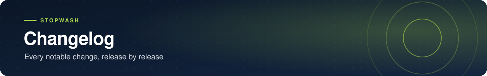

 

<strong>Every notable change to this project, newest first.</strong>

---

> [!NOTE]
> The format follows [Keep a Changelog](https://keepachangelog.com/en/1.1.0/) and the project uses [Semantic Versioning](https://semver.org/spec/v2.0.0.html). Each version links to its full comparison at the bottom of this page, and to its [release notes](https://github.com/saadmaz/Stopwash-Website/releases).

## [Unreleased]

### Fixed

- Other stopwash.lk subdomains (such as the POS) no longer show Cloudflare's "There is nothing here yet" page. Preview URLs are off, so Cloudflare no longer adds a hidden wildcard that answered every subdomain.

## [1.2.4] - 2026-11-17

### Removed

- 45 unused UI components, an unused hook and 34 unused dependencies. Installs and the repository are smaller; the site and its behaviour are unchanged.

## [1.2.3] - 2026-11-17

### Changed

- Contributing, Security Policy, Code of Conduct, License and Changelog redesigned with branded headers, navigation, tables, diagrams and callouts; the licence is now LICENSE.md.

## [1.2.2] - 2026-11-17

### Changed

- README shows the development environment as awaiting host setup until development deploys are enabled.

## [1.2.1] - 2026-11-17

### Changed

- Redesigned README with a brand banner, live release, CI and deployment badges, action buttons, feature grid, diagrams and collapsible panels.
- Navigation bars and callouts across the contributing, security, conduct and documentation pages.

### Fixed

- Production smoke test no longer fails when Cloudflare's bot protection challenges the CI runner; the challenge confirms the site is up.

## [1.2.0] - 2026-11-17

### Added

- Development and production environments: `develop` deploys to development and `main` to production, through one Deploy workflow and GitHub Environments with per-environment settings.

## [1.1.0] - 2026-11-16

### Added

- Cloudflare Workers production setup: `wrangler.jsonc` with the worker name, pinned compatibility date, a workers.dev address with branch preview URLs, and logging. Custom domains are attached in the Cloudflare dashboard.
- Permanent redirect from www.stopwash.lk to stopwash.lk, and security headers (HSTS, nosniff, frame, referrer and permissions policies) on every page.
- Deployment through Cloudflare Workers Builds (the repository connected in the Cloudflare dashboard deploys every push to main), plus `deploy` and `preview:worker` scripts for manual use.
- Tests for the www redirect.
- "Brand & dealer partnership" enquiry type on the Contact form; the B2B tile links straight to it.
- Homepage "Our outlets" section above the closing call to action, showing each open outlet as a card with address, phone, opening hours, directions and the map.
- Homepage "Why STOPWASH" section on white: the statement centred in large capitals above an arc of real STOPWASH-ED customer photos that runs from the bottom-left to the bottom-right corner, each card tilted along the curve, drifting slowly sideways. It fits one screen on laptops, monitors and phones, moves only while the section is on screen, and stays still for visitors who prefer reduced motion.
- "Why the name?" is now a compact navy band on the homepage: the STOPWATCH to STOPWASH wordmark beside a short explanation and a link to the story.
- Katubedda outlet details: 239 Model Town Rd, Moratuwa 10400, open every day 9:00 am to 9:00 pm, with the official Google Maps embed and directions to the exact pin.
- Local business structured data now includes the street address, map pin and opening hours.
- New link preview image for social sharing, cropped from the homepage photograph.
- New homepage hero photograph and headline: "Giving you back the gift of time".
- Franchise page hero photograph of the STOPWASH kiosk.
- Image folders for photos, location photos and brand files, with a guide in `src/assets/README.md`.
- Dependabot configuration, `.editorconfig` and `.gitattributes`.
- Lint step in continuous integration.
- Standard documentation layout shared by every STTPS repository: architecture, configuration, deployment, decision records (ADRs) and release and rollback runbooks, indexed in `docs/README.md`.

### Changed

- Social links now point to the STOPWASH Instagram, TikTok and LinkedIn profiles.
- Homepage "How it works" section now has a navy background.
- Homepage franchise card is now aligned to the navigation width, with larger type and rewritten copy ("One outlet proves the idea. A network changes the category."), a "Become a franchisee" button and a link straight to the franchise FAQ.
- Homepage Services section now presents the two STOPWASH formats, high-traffic hotspots ("Clean while you're out.") and fleet and brand partnerships ("Your fleet's detailing partner.", official partner to JETOUR, JAC and DONGFENG), as full-height photo tiles with matching amounts of text that fit one screen, with a link to all services. The six individual service cards moved off the homepage.
- Homepage order: Services now follows "Why the name?", ahead of "What we are building".
- Location cards: the map now fills the full height of the card.
- Services, Locations, Our Story, Our Vision, Our Standard, Blog and Contact open with a full-screen landing hero, matching Home and Franchise. Pages without a photograph show a branded backdrop until one is supplied.
- Navigation bar is transparent over every landing hero until the visitor scrolls.
- Contact, Locations and Blog heroes are shorter (about 70% of the screen) so the form, map and posts are reached sooner.
- Homepage hero: one-line introduction, and the second button now leads to Services.
- Browser title now reads "Giving You Back the Gift of Time".
- Location status badge reads "Open" instead of "Open now".
- Homepage hero fills the full screen, with the text aligned further left.
- Hero photos show uncropped on wide screens and start below the navigation bar.
- Navigation: "Franchise" moved out of the menu into the primary button, now labelled "Become a franchisee".
- Franchise "At a glance" facts moved from the hero into a strip directly below it.

### Removed

- Supabase: the database, its client library, schema and settings. The Contact and Franchise forms now open a ready-to-send email to hello@stopwash.lk.
- Facebook and YouTube icons (no profiles yet).
- "Our promise" section from the homepage.
- Round "scroll down" arrow at the bottom of the page heroes.
- "Our first outlet" section from the homepage (replaced by "Our outlets").
- "The STOPWASH difference" section (Motion, Precision, Repeatability) from the homepage.
- Gmail address from the footer, Contact, Privacy Policy and Terms; hello@stopwash.lk is the single contact address.
- "General enquiries" card on the Contact page (it duplicated hello@stopwash.lk).
- "Now open in Katubedda" tag from the homepage hero.

## [1.0.0] - 2026-11-15

First production release of [stopwash.lk](https://stopwash.lk).

### Added

- Home page with hero, brand story, services preview, how-it-works and franchise call to action.
- About pages: Our Story, Our Vision and The STOPWASH Standard.
- Services page with the full service catalogue.
- Locations page with directions, click-to-call and map support; Katubedda outlet listed.
- Franchise page with programme overview, partner criteria, journey, FAQ and application form.
- Contact page with an enquiry form.
- Blog with Markdown posts, tags, reading time, drafts and an RSS feed.
- Privacy Policy and Terms and Conditions pages.
- Server-side rendering with per-page SEO metadata, Open Graph images, `sitemap.xml`, `robots.txt` and structured data.
- Enquiry storage in Supabase with insert-only row-level security, schema validation and spam protection.
- Branded 404 and error pages.
- Continuous integration on every push and pull request: type check, tests and production build.
- Project documentation, contribution guidelines, security policy and issue templates.

### Changed

- Brand lime softened from `#B6FF00` to `#B2E04C` for a calmer, more comfortable look.

[Unreleased]: https://github.com/saadmaz/Stopwash-Website/compare/v1.2.4...HEAD
[1.2.4]: https://github.com/saadmaz/Stopwash-Website/compare/v1.2.3...v1.2.4
[1.2.3]: https://github.com/saadmaz/Stopwash-Website/compare/v1.2.2...v1.2.3
[1.2.2]: https://github.com/saadmaz/Stopwash-Website/compare/v1.2.1...v1.2.2
[1.2.1]: https://github.com/saadmaz/Stopwash-Website/compare/v1.2.0...v1.2.1
[1.2.0]: https://github.com/saadmaz/Stopwash-Website/compare/v1.1.0...v1.2.0
[1.1.0]: https://github.com/saadmaz/Stopwash-Website/compare/v1.0.0...v1.1.0
[1.0.0]: https://github.com/saadmaz/Stopwash-Website/releases/tag/v1.0.0
