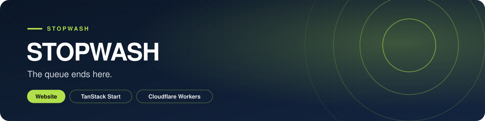
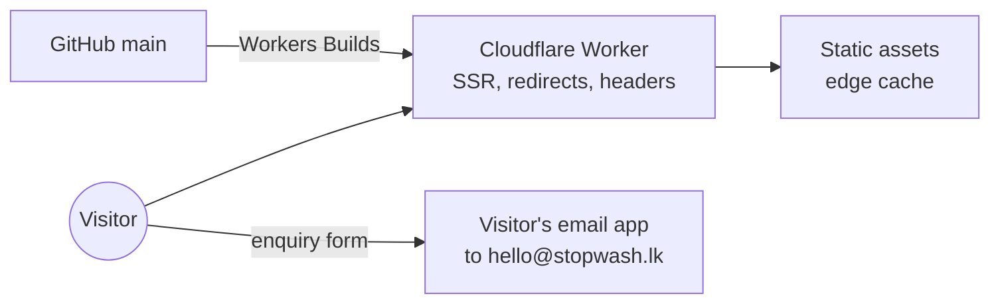
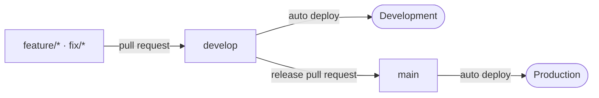

<a id="readme-top"></a>

<div align="center">



<br/>

<p><strong>The official website of STOPWASH: a faster, sharper and more dependable vehicle-care network in Sri Lanka.</strong></p>

<a href="https://github.com/saadmaz/Stopwash-Website/releases"></a>
<a href="https://github.com/saadmaz/Stopwash-Website/actions/workflows/ci.yml"></a>
<a href="https://github.com/saadmaz/Stopwash-Website/deployments"></a>
<a href="https://github.com/saadmaz/Stopwash-Website/commits/develop"></a>


<br/>

<a href="https://stopwash.lk"></a>
<a href="docs/README.md"></a>
<a href="https://github.com/saadmaz/Stopwash-Website/issues/new?template=bug_report.yml"></a>
<a href="https://github.com/saadmaz/Stopwash-Website/issues/new?template=feature_request.yml"></a>

<br/>

<a href="#about">About</a> ·
<a href="#features">Features</a> ·
<a href="#architecture">Architecture</a> ·
<a href="#getting-started">Getting started</a> ·
<a href="#deployment">Deployment</a> ·
<a href="#documentation">Documentation</a> ·
<a href="#contributing">Contributing</a>

</div>

---

<details>
<summary><strong>Table of contents</strong></summary>

1. [About](#about)
2. [Features](#features)
3. [Architecture](#architecture)
4. [Tech stack](#tech-stack)
5. [Getting started](#getting-started)
6. [Configuration](#configuration)
7. [Project structure](#project-structure)
8. [Quality checks](#quality-checks)
9. [Deployment](#deployment)
10. [Documentation](#documentation)
11. [Releases and versioning](#releases-and-versioning)
12. [Contributing](#contributing)
13. [Security](#security)
14. [License](#license)

</details>

## About

STOPWASH is building a connected vehicle-care network for people who keep moving. The first outlet is open in Katubedda, with a franchise programme to take the network national.

This repository powers [stopwash.lk](https://stopwash.lk): the brand, service and location information customers use to find a STOPWASH, and the franchise funnel operators use to apply to build one.

| At a glance      |                                                                 |
| ---------------- | --------------------------------------------------------------- |
| **Organisation** | STOPWASH PVT LTD                                                |
| **Status**       | Live                                                            |
| **Website**      | [stopwash.lk](https://stopwash.lk)                              |
| **Contact**      | [hello@stopwash.lk](mailto:hello@stopwash.lk) · +94 70 622 5252 |
| **Maintainer**   | [Saad Mazhar](https://github.com/saadmaz)                       |

<p align="right"><a href="#readme-top">Back to top ↑</a></p>

## Features

<table>
<tr><td width="50%" valign="top"><strong>Brand and story pages</strong><br/>Home, Our Story, Our Vision and The STOPWASH Standard.</td><td width="50%" valign="top"><strong>Services</strong><br/>The full service catalogue with clear levels of care.</td></tr>
<tr><td width="50%" valign="top"><strong>Locations</strong><br/>Outlet cards with directions, click-to-call and an embedded map when coordinates are set.</td><td width="50%" valign="top"><strong>Franchise funnel</strong><br/>Programme overview, partner criteria, journey, FAQ and an application form.</td></tr>
<tr><td width="50%" valign="top"><strong>Contact</strong><br/>Enquiry form with service, franchise and general enquiry types.</td><td width="50%" valign="top"><strong>Blog</strong><br/>Markdown posts with tags, reading time, drafts and an RSS feed.</td></tr>
<tr><td width="50%" valign="top"><strong>Server-side rendering</strong><br/>for fast first paint and complete HTML for search engines.</td><td width="50%" valign="top"><strong>SEO built in</strong><br/>Per-page titles, descriptions and Open Graph images, a generated <code>sitemap.xml</code>, <code>robots.txt</code> and <code>AutoWash</code> structured data.</td></tr>
<tr><td width="50%" valign="top"><strong>Spam-resistant forms</strong><br/>Schema validation, a honeypot field and a minimum fill time. Enquiries arrive by email, with no database to manage.</td><td width="50%" valign="top"><strong>Accessible by default</strong><br/>Skip link, visible keyboard focus, reduced-motion support and WCAG AA colour contrast.</td></tr>
</table>

<p align="right"><a href="#readme-top">Back to top ↑</a></p>

## Architecture

A server-rendered TanStack Start application on Cloudflare Workers. Pages render in the Worker, which also applies the `www` redirect and security headers. Enquiry forms validate in the browser and open a pre-filled email to the STOPWASH inbox; the site stores no personal data.



> [!TIP]
> The full design, with every component and data flow, is in [docs/ARCHITECTURE.md](docs/ARCHITECTURE.md). Significant decisions are recorded as [architecture decision records](docs/adr/README.md).

<p align="right"><a href="#readme-top">Back to top ↑</a></p>

## Tech stack

<p>


</p>

<details>
<summary><strong>Full stack breakdown</strong></summary>

| Layer     | Technology                                                                       |
| --------- | -------------------------------------------------------------------------------- |
| Framework | [TanStack Start](https://tanstack.com/start) (React 19, SSR, file-based routing) |
| Language  | TypeScript (strict)                                                              |
| Styling   | Tailwind CSS v4 with design tokens in `src/styles.css`                           |
| Motion    | Framer Motion, with CSS animations for server-rendered content                   |
| Forms     | React Hook Form + Zod                                                            |
| Content   | Markdown via `marked`                                                            |
| Build     | Vite 8 + Nitro                                                                   |
| Hosting   | Cloudflare Workers (default)                                                     |
| Tooling   | Bun, Vitest, Testing Library, ESLint, Prettier                                   |

</details>

<p align="right"><a href="#readme-top">Back to top ↑</a></p>

## Getting started

### Prerequisites

- [Bun](https://bun.sh) 1.x (recommended) or Node.js 20+
- Git

### Install and run

```sh
git clone https://github.com/saadmaz/Stopwash-Website.git
cd Stopwash-Website
bun install
bun run dev
```

The site runs at **http://localhost:8080**. If that port is busy, Vite picks the next free one and prints it.

<details>
<summary><strong>All scripts</strong></summary>

| Command              | Description                                  |
| -------------------- | -------------------------------------------- |
| `bun run dev`        | Start the development server with hot reload |
| `bun run build`      | Production build into `.output/`             |
| `bun run preview`    | Serve the production build locally           |
| `bun run typecheck`  | Type-check the project with `tsc`            |
| `bun run test`       | Run the test suite once                      |
| `bun run test:watch` | Run tests in watch mode                      |
| `bun run lint`       | Lint with ESLint                             |
| `bun run format`     | Format with Prettier                         |

</details>

<p align="right"><a href="#readme-top">Back to top ↑</a></p>

## Configuration

The site needs no environment variables. Contact details, services, locations and the form destinations live in `src/data/site.ts`; Worker settings live in `wrangler.jsonc`.

<details>
<summary><strong>Environment variables</strong></summary>

| File               | Controls                                                                                                  |
| ------------------ | --------------------------------------------------------------------------------------------------------- |
| `wrangler.jsonc`   | Worker name, compatibility date, `workers.dev` and preview URLs, observability, and any non-secret `vars` |
| `src/server.ts`    | `www` redirect and security headers                                                                       |
| `vite.config.ts`   | Build configuration                                                                                       |
| `src/data/site.ts` | Business data, including `customerEmail` and `franchiseEmail`, the form destinations                      |

Where each value is set, and which are secret: [docs/CONFIGURATION.md](docs/CONFIGURATION.md).

</details>

> [!NOTE]
> Copy, business data, imagery and articles are edited as described in [docs/CONTENT.md](docs/CONTENT.md).

<p align="right"><a href="#readme-top">Back to top ↑</a></p>

## Project structure

<details>
<summary><strong>Repository layout</strong></summary>

```
.
├── .github/                  # CI workflow, issue and pull request templates
├── public/                   # Static files: favicons, robots.txt, blog images
├── _incoming/                # Drop zone for new raw images (ignored by git)
├── src/
│   ├── assets/
│   │   ├── photos/           # Site photography
│   │   ├── locations/        # One photo per outlet
│   │   └── brand/            # Logo files
│   ├── components/
│   │   ├── site/             # Site components: Navbar, Footer, forms, cards
│   │   └── ui/               # Headless UI primitives (Radix-based)
│   ├── content/blog/         # Blog posts in Markdown
│   ├── data/site.ts          # Site content: contact, navigation, services, locations
│   ├── lib/                  # Blog loader, form schemas, email builder, helpers
│   ├── routes/               # File-based routes, one file per page
│   ├── styles.css            # Design tokens, type scale and section themes
│   └── test/                 # Vitest setup and tests
├── wrangler.jsonc            # Cloudflare Workers configuration
└── vite.config.ts            # Build configuration
```

</details>

<p align="right"><a href="#readme-top">Back to top ↑</a></p>

## Quality checks

Every pull request into `develop` or `main` runs the [CI workflow](.github/workflows/ci.yml): lint, type check, tests and a production build. Pull requests merge only when CI is green.

```sh
bun run lint && bun run typecheck && bun run test && bun run build
```

> [!IMPORTANT]
> Run the same checks locally before opening a pull request. They are the exact commands CI runs.

<p align="right"><a href="#readme-top">Back to top ↑</a></p>

## Deployment

| Environment | Branch    | URL                                        | Status                                                                                                                                                          |
| ----------- | --------- | ------------------------------------------ | --------------------------------------------------------------------------------------------------------------------------------------------------------------- |
| Development | `develop` | [dev.stopwash.lk](https://dev.stopwash.lk) |   |
| Production  | `main`    | [stopwash.lk](https://stopwash.lk)         |  |



Cloudflare Workers Builds builds and serves each branch; the Deploy workflow verifies the build and the live URL. Environments, setup, secrets and post-deployment checks are in [docs/DEPLOYMENT.md](docs/DEPLOYMENT.md).

> [!TIP]
> To ship or undo a release, follow the [release](docs/runbooks/release.md) and [rollback](docs/runbooks/rollback.md) runbooks.

<p align="right"><a href="#readme-top">Back to top ↑</a></p>

## Documentation

Every STTPS repository uses the same documentation layout.

| Document                               | Covers                                               |
| -------------------------------------- | ---------------------------------------------------- |
| [Documentation index](docs/README.md)  | Every document in this repository                    |
| [Architecture](docs/ARCHITECTURE.md)   | How the system is built and how data flows           |
| [Configuration](docs/CONFIGURATION.md) | Environment variables and configuration files        |
| [Deployment](docs/DEPLOYMENT.md)       | Environments, hosting, pipeline and first-time setup |
| [Content](docs/CONTENT.md)             | Updating copy, business data, imagery and articles   |
| [Decision records](docs/adr/README.md) | Why the system is built the way it is                |
| [Runbooks](docs/runbooks/README.md)    | Release and rollback procedures                      |

<p align="right"><a href="#readme-top">Back to top ↑</a></p>

## Releases and versioning

[](https://github.com/saadmaz/Stopwash-Website/releases)

The project follows [Semantic Versioning](https://semver.org). Every release is tagged `vX.Y.Z`, published on the [Releases](https://github.com/saadmaz/Stopwash-Website/releases) page with its notes, and recorded in [CHANGELOG.md](CHANGELOG.md). The procedure is in [docs/runbooks/release.md](docs/runbooks/release.md).

<p align="right"><a href="#readme-top">Back to top ↑</a></p>

## Contributing

| Step |                                                                           |
| ---- | ------------------------------------------------------------------------- |
| 1    | Branch from `develop` using a type prefix (`feat/`, `fix/`, `docs/`, ...) |
| 2    | Commit with [Conventional Commits](https://www.conventionalcommits.org)   |
| 3    | Open a pull request into `develop` and complete the checklist             |
| 4    | Squash and merge once CI is green and the change is reviewed              |

The full guide is in [CONTRIBUTING.md](CONTRIBUTING.md). Everyone taking part follows the [Code of Conduct](CODE_OF_CONDUCT.md).

<p align="right"><a href="#readme-top">Back to top ↑</a></p>

## Security

> [!IMPORTANT]
> Never report a vulnerability in a public issue. Follow [SECURITY.md](SECURITY.md) to report it privately; you will hear back within three business days.

<p align="right"><a href="#readme-top">Back to top ↑</a></p>

## License

Copyright © 2026 STOPWASH PVT LTD. All rights reserved.

This is proprietary software. The source is publicly visible, but no permission is granted to use, copy, modify or distribute it without prior written consent. See [LICENSE](LICENSE).

<div align="center">
<br/>
<sub>Built and maintained by the STOPWASH team · Part of the <a href="https://sttps.co">STTPS group</a></sub>
</div>
