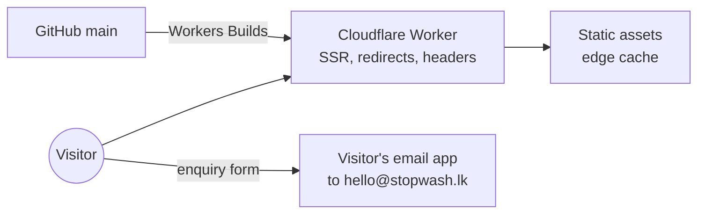

# Architecture

<!-- nav -->

<a href="../README.md">Project README</a> · <a href="README.md">Documentation index</a>

> How stopwash.lk is built and served. Part of the [project documentation](README.md).

## Overview

stopwash.lk is a server-rendered TanStack Start application running on Cloudflare Workers. Pages render in the Worker for complete HTML and a fast first paint; static files are served from Cloudflare's edge.

## Building blocks

| Part                | Responsibility                                                    |
| ------------------- | ----------------------------------------------------------------- |
| `src/routes/`       | File-based routes, one file per page (see `src/routes/README.md`) |
| `src/data/site.ts`  | Contact details, navigation, services and locations               |
| `src/content/blog/` | Blog posts in Markdown                                            |
| `src/lib/`          | Blog loader, form schemas, email builder and helpers              |
| `src/server.ts`     | Worker entry: `www` redirect and security headers                 |
| `src/styles.css`    | Design tokens, type scale and section themes                      |

## Forms

The Contact and Franchise forms do not use a database or any third-party service. When a visitor submits:

1. the form is validated against the Zod schemas in [`src/lib/enquiries.schema.ts`](../src/lib/enquiries.schema.ts),
2. submissions with the honeypot field filled, or completed implausibly fast, are dropped,
3. the visitor's email app opens with a message to `hello@stopwash.lk`, with the subject and every field already written out ([`src/lib/enquiries.email.ts`](../src/lib/enquiries.email.ts)). They press **Send**.

Enquiries therefore arrive in the `hello@stopwash.lk` inbox. To change the destination, update `customerEmail` and `franchiseEmail` in `src/data/site.ts`.

Significant decisions are recorded in [adr/](adr/README.md).
